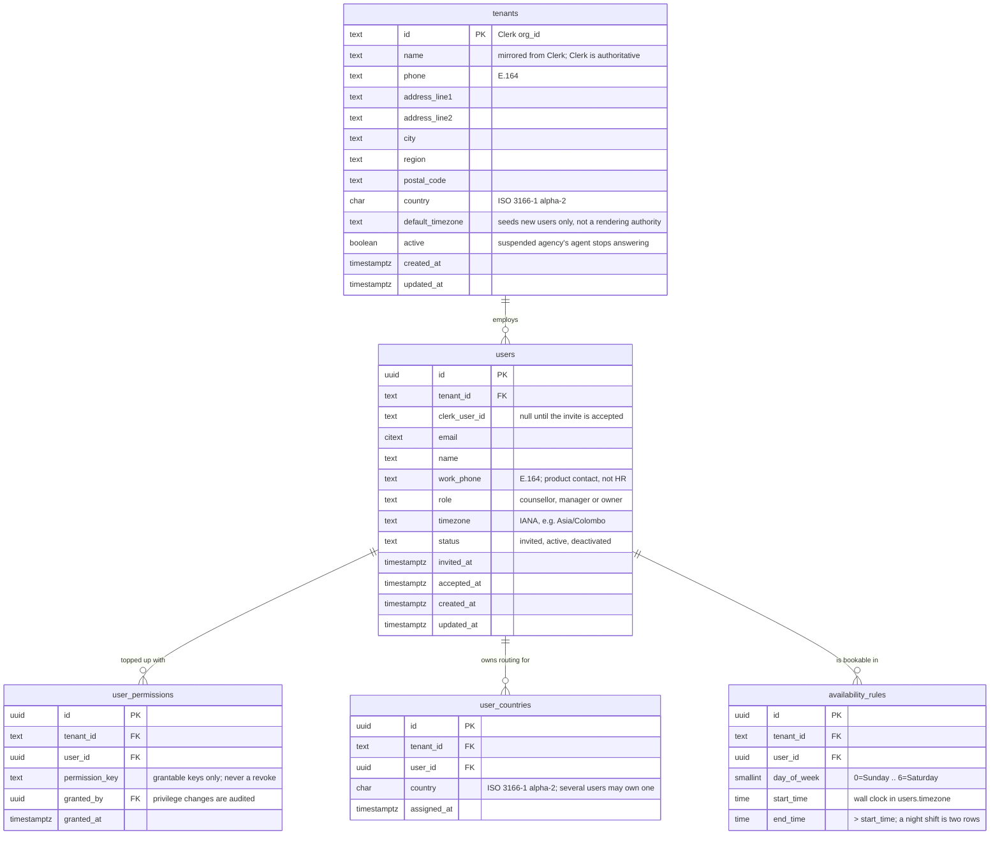
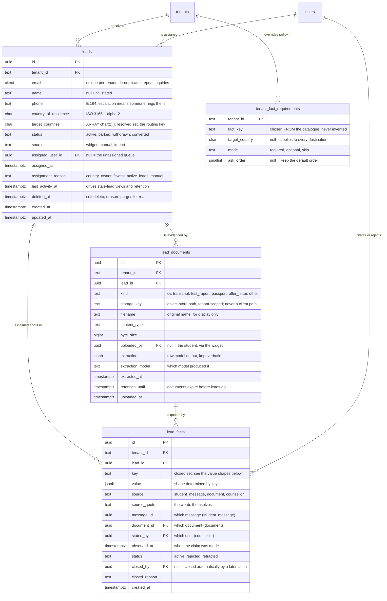
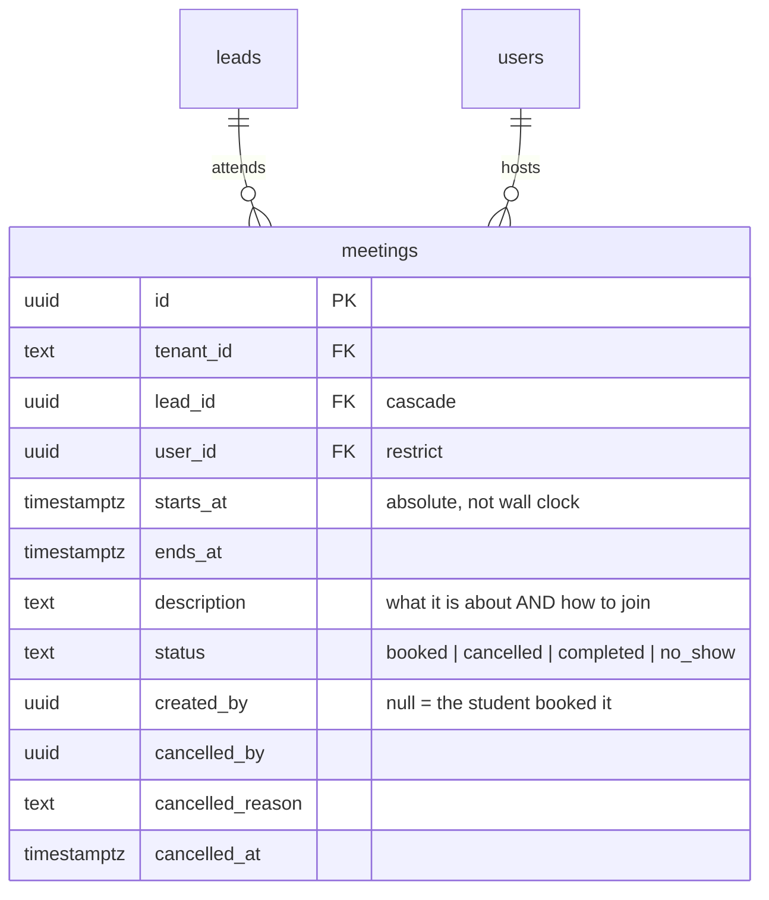
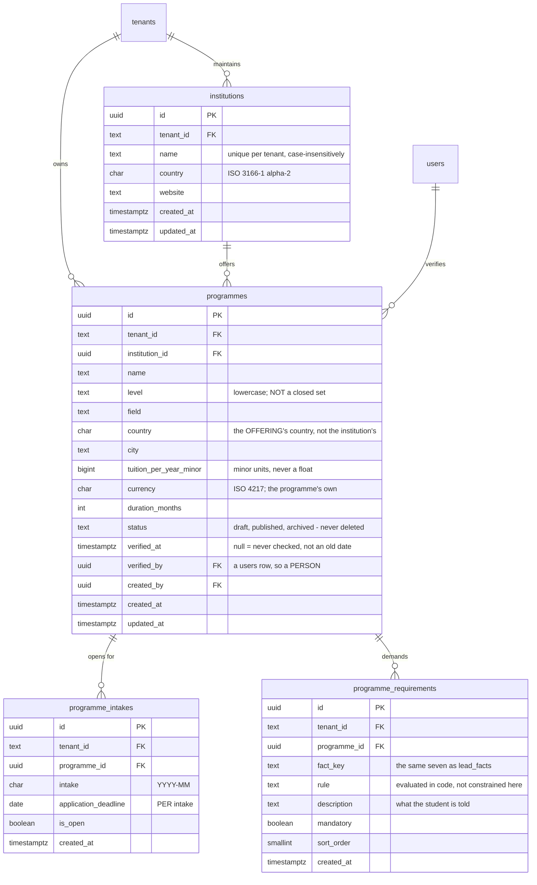

# Northbound — data model (1: people and access)

> Part 1 — people and access (below) · [Part 2 — leads and facts](#northbound--data-model-2-leads-and-facts) · [Part 3 — meetings](#northbound--data-model-3-meetings) · [Part 4 — the catalogue](#northbound--data-model-4-the-catalogue)

Who works at an agency, what they may do, and when they are reachable. The
lead record is part 2; catalogue and audit tables come later.

Shared database, shared schema. Every table carries `tenant_id` — the Clerk
organization id, which is why it is `text` and not a uuid. Identity comes from
Clerk (who you are, which agencies you belong to); authorization comes from
here (what you may do inside one).

Migrations: `001` created the people-and-access tables; `002` replaced
tenant-owned role rows with an enum and moved the permission catalogue into
`student_agent/permissions.py`.

## The access model

A **role** is one of three fixed values on `users`. A user may additionally be
granted individual permissions on top of it — so a counsellor can be given
catalogue editing without being promoted to manager and inheriting every lead
in the agency.

    effective permissions = ROLE_PERMISSIONS[user.role]  ∪  the user's grants

Grants only ever ADD. There is no revoke: a plain union is what keeps "why can
Priya do this?" answerable in one query. Someone who needs less gets a lower
role.

The catalogue lives in code rather than a table because a permission only
means something if a code path checks it — a key nobody checks is a setting
that silently does nothing. `permissions.py` is the single place permissions
resolve; the `user_permissions` CHECK constraint is the same rule stated at
the boundary, and a test asserts the two have not drifted.

Creating an agency costs **2 rows**: one `tenants`, one `users` as owner.



## The permission catalogue

Defined in `student_agent/permissions.py`. Scope is a permission rather than
something hardcoded per role, so the grant mechanism covers visibility as well
as capability.

| Key | counsellor | manager | owner | Grantable |
|---|:--:|:--:|:--:|:--:|
| `leads.read.owned` | ✓ | | | ✓ |
| `leads.read.all` | | ✓ | ✓ | ✓ |
| `leads.write` | ✓ | ✓ | ✓ | ✓ |
| `leads.assign` | | ✓ | ✓ | ✓ |
| `catalogue.read` | ✓ | ✓ | ✓ | ✓ |
| `catalogue.flag` | ✓ | ✓ | ✓ | ✓ |
| `catalogue.write` | | ✓ | ✓ | ✓ |
| `catalogue.verify` | | ✓ | ✓ | ✓ |
| `users.edit` | | ✓ | ✓ | ✓ |
| `users.invite` | | | ✓ | — |
| `users.countries.manage` | | ✓ | ✓ | — |
| `users.deactivate` | | | ✓ | — |
| `tenant.settings` | | | ✓ | — |

The last column is a separate question from the first three. `users.invite`,
`users.countries.manage`, `users.deactivate` and `tenant.settings` are absent
from the `user_permissions` CHECK and so cannot be granted individually — handing them
out one at a time is how someone is promoted by the back door.

But not grantable does not mean owner-only. A manager holds
`users.countries.manage` by role: moving a country when a counsellor goes on
leave is day-to-day team management, not a tenant-wide setting. The flag in
`permissions.py` is therefore named `grantable`, after what it actually
enforces.

Priya as a counsellor granted `catalogue.write` is the case this model exists
for: she edits programmes without gaining lead visibility, invites or tenant
config.

## The unassigned queue is visible to everyone

A counsellor sees leads in their owned countries **plus every unassigned lead**,
including countries nobody owns. An escalated lead that no one can see is the
failure the escalation rules exist to prevent, so the queue is deliberately not
filtered by ownership.

## Constraints

- `unique (tenant_id, clerk_user_id)` and `unique (tenant_id, email)` — scoped
  to the tenant, because one person may work at two agencies and their email
  legitimately repeats across them.
- `unique (user_id, permission_key)` — a permission granted twice is a bug.
- `unique (user_id, country)` — one ownership row per user per country.
- `check (end_time > start_time)` and `check (day_of_week between 0 and 6)`.

## Enforced by the database, not by discipline

- **No cross-tenant reference is possible.** Every child references its parent
  on `(tenant_id, id)`, not on `id` alone, so a `user_countries` row cannot
  point at a user in another agency.
- **Owner-only permissions cannot be granted individually** — the
  `user_permissions` CHECK does not list them.
- **An invented permission key is refused** by the same CHECK. `permissions.py`
  states the same rule a second time, intersecting grants with GRANTABLE before
  the union: the CHECK means such a row should not exist, and "should not
  exist" stops being a guarantee the moment a restored dump or a hand-run
  UPDATE is involved.
- **`role` is one of three values**, CHECKed rather than free text.
- **An active user must be linked to Clerk** — `check (status <> 'active' or
  clerk_user_id is not null)`.

## Rules no constraint can express

- **Every tenant keeps at least one owner.** The last one cannot be demoted,
  deactivated or removed, or the agency locks itself out permanently.
- **The agency creator is seeded as owner**, before any UI to grant it exists.
- **Effective permissions resolve in one place** — `permissions.py`. Two
  implementations would disagree eventually.
- **Routing must skip anyone not active.** Deactivation leaves `user_countries`
  intact on purpose: `invite()` revives the same row, and releasing the
  countries would reset `assigned_at` on ownership the person may hold again
  next week. Nothing reads that table for routing yet. When something does, it
  filters `users.status = 'active'`, or a lead routes to someone who cannot
  sign in and never reaches the unassigned queue.
- **An agency keeps at least one ACTIVE owner.** Enforced in
  `repositories.users.deactivate`, which locks the tenant's owner rows before
  counting — check-then-act would let two owners switch each other off at the
  same instant and leave none. Invited and deactivated owners are not cover: an
  invitation cannot accept itself, and `users.invite` is owner-only, so an
  agency in that state cannot be repaired from inside the product. Unreachable
  over HTTP today, because self-deactivation is refused first and any other
  target proves a second owner exists; the guard lives in the repository so
  that demoting an owner inherits it rather than reinventing it.
- **Availability windows do not overlap.** `availability_rules` carries no
  exclusion constraint, so the database will happily store a counsellor as
  available twice at once; the guard lives in `PUT /api/users/{id}/availability`
  and nowhere else. Two windows that TOUCH are fine — a morning ending at 12:00
  beside an afternoon starting at 12:00 is an ordinary split shift — so the
  comparison is `<`, not `<=`. Making this a real constraint means a migration
  enabling `btree_gist` and an `EXCLUDE` on
  `(tenant_id, user_id, day_of_week, timerange(start_time, end_time))`; worth
  doing the day anything other than this endpoint writes the table.
- **A shift cannot cross midnight in one row.** `end_time > start_time` is
  CHECKed, so 22:00-02:00 is stored as 22:00-24:00 plus 00:00-02:00. The API
  refuses the single-row form rather than splitting it silently, so the week a
  client draws is the week we hold. Postgres `time` includes 24:00:00, which is
  what makes the first half expressible; Python's `datetime.time` stops at
  23:59:59, so every read goes through `to_char` and times cross the driver as
  text.

## Deliberately absent

No HR data — home address, personal phone, leave. HR is a different product;
if it lands it will be a `user_hr_profiles` table behind its own permission,
not columns here. No password or avatar: Clerk owns those, and mirroring
creates drift.

Agencies cannot define roles of their own. That was built and then removed in
`002` — it cost four tables and 30 rows per signup to serve a need no customer
has yet stated. It comes back as a migration if one does.

There is no tenant timezone as a rendering authority — times render in the
viewer's zone per CLAUDE.md; `default_timezone` seeds a new user's `timezone`
and nothing more.

---

# Northbound — data model (2: leads and facts)

The student, what we have been told about them, and the documents that back it
up. Of what this section originally promised for `004`, only booked
consultations have landed — as [`meetings`](#northbound--data-model-3-meetings),
not `slots`, for the reason given there. Conversation, notes, escalations and
follow-ups are still to come, each as its own migration; programmes and
requirements are their own slice.

Migration `003` creates `leads`, `lead_facts`, `lead_documents` and
`tenant_fact_requirements`.

## One idea underneath all of it

`lead_facts` is **a log of claims, not a row of answers.**

Several rows for the same `key` is the normal case, not a conflict to clean up.
A student says their GPA is 3.4; two days later their transcript says 3.38.
Both are true statements about what we were told, they were told to us by
different sources with different authority, and neither should overwrite the
other. "What is this student's GPA?" is answered by a **rule over the log**,
not by reading a column.

This is what makes the product's central promise cheap to keep: *facts are
quoted, never inferred*, and every value on screen can be traced back to the
words it came from.



## Fact keys and their value shapes

The key set is closed and lives in `student_agent/agent/facts.py`. A CHECK
constraint states the same list at the database boundary.

| Key | Value shape |
|---|---|
| `target_country` | `{"country": "GB", "preference": 1}` — or `{"status": "undecided"}` |
| `field_of_study` | `{"field": "data science"}` |
| `qualification` | `{"level": "bachelor", "years": 3, "subject": "...", "institution": "...", "country": "IN"}` |
| `grades` | `{"system": "percentage", "value": 72, "scale": 100, "country": "IN"}` |
| `english_test` | `{"test": "IELTS", "overall": 6.5, "listening": 7.0, "reading": 6.5, "writing": 6.0, "speaking": 6.5, "taken_on": "2025-03-14"}` |
| `budget_per_year` | `{"amount": 2500000, "currency": "GBP"}` — minor units |
| `intended_intake` | `{"year": 2027, "month": 9}` |

Three of these are structured because the flat version cannot answer a real
entry requirement:

- **`english_test`** — a UK masters asks for *"6.5 overall with no band below
  6.0"*. `"IELTS 6.5"` cannot answer that. The seed data proves the point: the
  quote *"IELTS 6.5 overall, 6.0 in writing"* was stored as `"IELTS 6.5"`, so
  the student's own words carried a band score the schema then discarded.
- **`qualification`** — `Requirement.rule` is machine text like
  `bachelor_years>=4`. With the value as prose, evaluating it means parsing
  English with an LLM on every check. `years: 3` makes it arithmetic. This is
  the single most common eligibility question in South Asia → UK/Australia
  consulting.
- **`grades`** — `72` is meaningless without its system. An Indian 72%, a
  Chinese 85/100 and a US 3.4/4.0 are not comparable numbers, and one seed row
  (*"my GPA converts to about 88%"*) shows a student's own approximate
  conversion stored as a hard fact.

### Two keys hold a set, not a value

A student may want several countries, and several fields. `target_country` and
`field_of_study` therefore resolve to a SET, and each member is **its own
claim with its own quote**.

    key = target_country   value = {"country": "GB", "preference": 1}
                           quote = "I want to do my masters in the UK"

    key = target_country   value = {"country": "AU", "preference": 2}
                           quote = "actually i'm also looking at australia"

One row holding `["GB", "AU"]` is not possible without breaking the quote rule:
those two countries were named in two different messages, so no single quote
covers both, and writing one would mean inventing words the student never said.

`preference` is what the student stated, not a guess — a seed row says
*"Australia is my first choice"*. It is null when they did not rank them.

The same applies to `field_of_study`, and the seed data already shows the loss:
the quote *"something in data science or analytics"* was stored as
`"data science"`, so half of the student's answer disappeared.

A negative answer is a fact, not an absence: *"I haven't sat IELTS, booked for
November"* is `{"test": "IELTS", "status": "not_taken", "planned_for":
"2026-11"}`. It is actionable — it becomes a `test_result` follow-up — where a
null would be silence.

Value shapes are validated in code on write. The database CHECKs the key, not
the shape; a jsonb schema constraint would duplicate the Pydantic models and
the two would drift.

## Which claim wins

Resolved on read, by rule, never by overwrite. **The rule depends on whether
the key holds one value or a set.**

Scalar keys — `grades`, `english_test`, `qualification`, `budget_per_year`,
`intended_intake` — pick exactly one active claim:

    1. counsellor            a human checked the original
    2. official document     transcript, test_report, passport
    3. self-reported         a chat message, or a CV
    4. within a tier         most recent observed_at

Set-valued keys — `target_country`, `field_of_study` — take the **union** of
active claims, ordered by `preference` then `observed_at`.

Applying "most recent wins" to a set would be a data-loss bug: a student adding
Australia on Tuesday would silently lose the UK they asked for on Monday.

**A CV is not an official document.** The student wrote it, so it sits in the
self-reported tier alongside chat. That distinction is why trust derives from
`lead_documents.kind` rather than from `lead_facts.source` alone.

Neither a rejected nor a retracted claim resolves, and the difference
between them matters to whoever reads the history:

| status | meaning |
|---|---|
| `active` | stands |
| `rejected` | never valid evidence — *"this transcript is a different person"* |
| `retracted` | was true, no longer applies — *"I've decided against Canada"* |

`closed_by` is nullable, and null means *no human did this*. A student who
says they are undecided and then names a country has retracted the first claim
themselves; the retraction follows from the second claim, and requiring a user
id there would mean inventing a system account to satisfy a foreign key.

Only `rejected` casts doubt on the source. A student changing their mind is not
an error, and recording it as one would misread the lead's history. Both stay
visible, so nobody re-uploads the same document next month wondering where the
value went.

### Conflicts escalate; they do not resolve quietly

When two active claims for one key disagree materially and none is
counsellor-sourced, the key is **in conflict** and the lead escalates.

A CV claiming IELTS 7.0 against a test report saying 6.0 is not a tie for a
rule to break — it decides whether the student is eligible at all. Silently
preferring the document would also silently stop the agent telling that student
they qualify, with nobody informed. Same principle as `indeterminate`: the
system must be able to say *"we do not know"* out loud.

## What the agent is asked, and by whom

The checklist is **computed, never stored**:

    to_ask(lead) = required_for(tenant_id, lead) − keys_with_active_claims(lead)

`required_for()` resolves in two layers:

    1. the DEFAULT policy, in agent/facts.py — one copy for everybody
    2. overlaid with this tenant's rows in tenant_fact_requirements

Both layers select rows where `target_country` is null, plus rows matching
**any** country in this lead's resolved set. A student aiming at Germany and
the UK needs the German-language requirement and IELTS both; a key matched
twice is asked once.

The result is rendered into `<lead_facts>` and prepended to the student's
message on every turn (`agent/core.py::prepend_context`). **The agent never
queries for this.** The set difference happens in Python before the model runs,
and the model is handed the answer as text.

### The table holds overrides only

`tenant_fact_requirements` is empty for an agency that is happy with the
defaults, and creating an agency writes **no rows** into it.

Copying the default policy into every tenant at signup would work and would
also freeze it. Deciding a year later that `budget_per_year` should be optional
for everyone would then mean rewriting a hundred copies while trying to guess
which rows an agency had deliberately changed. Keeping the defaults in one
place makes that a one-line edit.

It also makes the table readable: three rows across a hundred agencies say
exactly what those three agencies do differently, where nine hundred rows bury
the same information under copies.

This is the shape of decision `002` already made — per-tenant `roles` and
`role_permissions` cost 30 rows a signup and became a code constant in
`permissions.py`.

`mode` is three-valued rather than a boolean because *"ask, but never block"*
and *"do not ask at all"* are both real settings, and `required = false` can
only express one of them.

A tenant chooses **which** keys are required. A tenant cannot **invent** keys —
`fact_key` is CHECKed against the same closed set, for the reason permissions
are: a key no code path evaluates is a question asked of a student for nothing.
Adding a key is a code change (value model, requirement evaluator, migration).
Letting agencies define their own is sketched under **Deliberately absent**.

## What reads and writes this

Not only the agent. Every table here has a human path too.

| Operation | Actor | Permission |
|---|---|---|
| Create a lead | widget (public), or a counsellor | — / `leads.write` |
| Read a lead + resolved facts | counsellor | `leads.read.owned` / `.all` |
| Read every claim, with sources | counsellor | `leads.read.owned` / `.all` |
| Write a fact from a chat message | agent | tool boundary |
| Write a fact from a phone call | counsellor | `leads.write` |
| Reject a claim | counsellor | `leads.write` |
| Upload a document | student (widget) or counsellor | — / `leads.write` |
| Re-run extraction on a document | counsellor | `leads.write` |
| Reassign a lead | manager | `leads.assign` |
| Edit the required-fact policy | owner | `tenant.settings` |

The agent and the counsellor write to the same table through the same
constraints. The only difference is which arm of the source CHECK they satisfy.

## Enforced by the database, not by discipline

- **A fact cannot exist without its evidence.** The source CHECK has three
  arms: `student_message` requires `source_quote` and `message_id`, `document`
  requires `source_quote` and `document_id`, `counsellor` requires `stated_by`.
  The anti-inference rule moves out of Pydantic and into the schema, where the
  CV extractor is bound by it too.
- **No cross-tenant reference is possible.** Children reference
  `(tenant_id, id)`, so a fact cannot cite another agency's document.
- **A deactivated counsellor's leads return to the queue** —
  `on delete set null (assigned_user_id)`. The column list is required: a bare
  `SET NULL` on a composite key nulls `tenant_id` too, which is NOT NULL.
- **Invented fact keys are refused**, in `lead_facts` and in
  `tenant_fact_requirements` — both CHECK the same closed set.
- **A closed claim names who closed it** — rejected and retracted alike.

## Rules no constraint can express

- **Value shapes match their key.** Validated in code, on both write paths.
- **`leads.target_countries` is a cache** of the resolved `target_country`
  set, maintained when those claims change. Nothing else may write it.
- **Set-valued keys union; scalar keys pick one.** Applying the scalar rule to
  a set silently drops destinations the student asked for.
- **Grades resolve across incompatible systems.** A lead may hold
  `percentage 72/100` from a chat message and `cgpa 6.8/10` from a transcript.
  The rule picks the transcript, but comparing either against a UK 2:1 needs a
  conversion table — a service that does not exist yet, and the kind of thing
  that gets hardcoded badly if nobody names it first.
- **Conflicting keys escalate** rather than resolving silently.
- **Extraction writes only catalogue keys.** Whatever else the model found
  stays in `lead_documents.extraction` and reaches no fact row.

## Routing

Routing uses `target_country`, not `country_of_residence` — agencies specialise
by destination ("the Australia desk").

A lead may target several countries, and different users may own each of them,
so the choice between candidates is stated here in full. CLAUDE.md requires it
be recorded rather than improvised, and this is that record:

    1. the user owning the student's HIGHEST-PREFERENCE target country
    2. if no preference was stated, any user owning ANY target country
    3. among candidates, fewest active leads
    4. ties broken by lowest user id
    5. no owner for any target country → the unassigned queue

Step 1 exists because a student who says *"Australia is my first choice"* has
told us where they want to be handled, and overriding that for load balance
would be the system knowing better than the person. Step 2 is what keeps the
rule total when they did not rank anything.

`leads.target_countries` is a `char(2)[]` cache of the resolved set, maintained
whenever a `target_country` claim changes, so the routing query stays a single
indexed table scan rather than a join into the claim log.

### A lead with no destination

*"I want to study abroad but I don't know where"* is a common and valuable
case — those students need the agency's advice most.

It is recorded as a claim, `{"status": "undecided"}`, with the student's own
words. Not as an absent row: without it `required_for()` keeps returning
`target_country` and the agent asks the same question every turn, having
already been answered.

Such a lead has no country to route on and joins the **unassigned queue**,
which every counsellor can see. That is the existing rule doing its job, not a
gap in it.

The agent's next move is to ask the OTHER facts. Budget, qualification, field
and intake narrow the field on their own — a student with £10,000 a year, a
three-year bachelor and no English test has few realistic destinations.

The agent may **not** name candidate countries from its own knowledge. That is
a fact, and tools are the only source of facts. Narrowing the choice needs a
catalogue-backed tool that returns countries with programmes actually matching
those facts; it belongs to the catalogue slice and does not exist yet.

When the student then chooses, that is an ordinary claim with a real quote, and
the `undecided` row is **retracted** — true when stated, no longer true. The
history then shows both that they started undecided and how they arrived.

## Deliberately absent

**No `escalated` status.** Lifecycle (`active`, `parked`, `withdrawn`,
`converted`) and "needs a human" are orthogonal — an escalated lead is still
active, and collapsing them loses what the lead was before it escalated and
whether a conversion followed one. Escalation is an unresolved row in
`escalations` (`004`), so there is one source of truth rather than a column two
code paths must keep in step.

**No `superseded_at` on facts.** With several live sources, "superseded" is the
wrong word: a transcript does not cancel the student's statement, it outranks
it. If that transcript is later rejected, the student's claim should stand
again on its own — a rule does that, a flag would need un-setting.

**No fact history table.** The log *is* the history.

**No list packed into one claim.** `target_country` as `["GB", "AU"]` in a
single row would need a `source_quote` covering both countries, which the
student never uttered in one message. One row per country keeps every value
attached to the words that produced it.

**No agency-defined fact keys — yet.** The key set is closed and a tenant
picks from it. An agency wanting a new fact needs five things it cannot supply
from a settings form: the key, a value shape, an evaluator, an extractor rule
and a widened CHECK. A description alone tells the model what a fact MEANS but
tells the code nothing about what it LOOKS like, so the same answer lands as
`320`, `"320"`, `"320/340"` and `"good"` on different days and every comparison
against it becomes unreliable.

The safe version, when it lands, is a `tenant_fact_definitions` table where the
agency supplies a description AND a declared type — number with bounds, text,
boolean, or one-of-a-list. The description steers the agent; the type lets the
code validate and compare. Facts carrying real domain logic — `grades`,
`english_test`, `qualification` — stay built in, because they are rules rather
than comparisons.

The cost is stated here so it is not a surprise: with tenant-defined keys the
database can no longer CHECK the vocabulary, and that validation moves into
code.

**No passport number column.** Store that the passport was seen, not what it
says. It is high-value for identity fraud and buys nothing operationally.

**No pre-seeded null rows.** A row here means *someone claimed something, and
here is the evidence*. A placeholder has no source, no quote and no timestamp,
so allowing one means making every provenance column nullable — dropping the
guarantee in order to store rows that carry no information. "Not yet asked" is
the absence of a row, which is what absence honestly means.

---

# Northbound — data model (3: meetings)

> [Part 1 — people and access](#northbound--data-model-1-people-and-access) · [Part 2 — leads and facts](#northbound--data-model-2-leads-and-facts) · Part 3 — meetings (below) · [Part 4 — the catalogue](#northbound--data-model-4-the-catalogue)

A booked consultation between one student and one counsellor. Migration `004`
creates `meetings` and enables `btree_gist`.

## There are no empty slots

The table holds **only meetings that were actually booked**. Free time is
derived — `availability_rules` minus the rows here — and never stored.

The alternative was to explode each counsellor's weekly pattern into concrete
bookable rows for the weeks ahead, then mark them taken. That design writes
thousands of rows whose content is "nothing is happening", and it turns every
edit of a weekly pattern into a reconciliation problem: which generated rows
get deleted, and what happens to the ones already booked inside a window the
counsellor has just removed? Deriving free time asks that question once, at
read time, where the answer cannot go stale.

Pre-generation earns its keep when a slot needs data of its own — a price, a
capacity, a duration that varies by type. None of that exists here, so the
table is named `meetings` rather than `slots`. `003`'s header promised "slots";
the name is the design, and a table called `slots` invites the discarded one
back in six months.



## Absolute time here, wall clock there

`availability_rules` stores a `day_of_week` and a bare `time`, read against
`users.timezone`. `meetings` stores `timestamptz`. That is not an
inconsistency — the two describe different kinds of thing.

A weekly pattern is one person's routine. "Monday 9am" has no date, belongs to
whoever set it, and means 9am *where they are*.

A meeting is a single instant that two people in two countries must both arrive
at. It has no timezone of its own; each side renders it in their own clock, as
`CLAUDE.md` requires. A bare "10:30" agreed between Colombo and London is a
missed call, which is exactly the failure this column type prevents.

## Enforced by the database, not by discipline

**A counsellor cannot be double-booked.** An `EXCLUDE USING gist` constraint on
`(user_id =, tstzrange(starts_at, ends_at, '[)') &&)`.

This is the reason the table exists in this shape. Two students clicking "book
10:30" in the same second is not an exotic race; it is the normal case for a
popular counsellor. An application that `SELECT`s for a clash and then
`INSERT`s loses that race every time, because both transactions read before
either writes. Stated as a constraint, overlap is not unlikely — it is
unrepresentable.

Three details in it carry weight:

- **`[)` is half-open**, so 10:00–10:30 and 10:30–11:00 do not overlap.
  Back-to-back meetings are the point of a calendar. This is the same call the
  availability API made when it compared windows with `<` rather than `<=`.
- **`WHERE status <> 'cancelled'`**, so a cancellation returns the time to the
  pool. Without it every cancelled meeting would poison its slot permanently,
  surfacing much later as "why can nobody book Tuesday at ten". `completed` and
  `no_show` still block: both describe time the counsellor actually gave up.
- **`user_id` without `tenant_id`.** `users.id` is a primary key and therefore
  already unique across tenants; adding it would widen the index to restate
  something the database guarantees.

**A meeting cannot end before it starts, or last no time at all.**
`CHECK (ends_at > starts_at)`.

**The cancellation timestamp and the status cannot disagree.**
`CHECK ((status = 'cancelled') = (cancelled_at is not null))` — the same
pairing `lead_facts` uses for its `closed_*` trio. It catches the easy half
(cancelled with no time) and the easily forgotten half (reinstating a meeting
without clearing the time).

**A meeting cannot cross tenants.** The composite foreign keys on
`(tenant_id, lead_id)` and `(tenant_id, user_id)`, as everywhere else.

## Rules no constraint can express

**A meeting need not fall inside an availability window.** Deliberately not
enforced. A counsellor takes an urgent call at 8pm, and hours get edited after
a booking already exists; enforcing it here would make both a database error
instead of a normal Tuesday. The booking path checks it and may be overridden,
and the grid draws such a meeting outside the painted region, where it reads
as what it is.

**Rescheduling is cancel-plus-book, never an in-place edit.** The original row
stays intact, the freed time returns through the `WHERE` above, and no new
columns are needed. Editing `starts_at` in place would silently destroy the
record of when the meeting used to be.

**Deactivating a counsellor must deal with their future meetings.**
`users.deactivate` reassigns open leads; it knows nothing about this table. A
counsellor switched off while students hold bookings against them is a real
hole, and closing it is application logic — cancel, reassign, or refuse — not
a constraint.

## Deliberately absent

**No exclusion constraint on `lead_id`.** The symmetric rule looks tidy and
would be wrong: a joint consultation — a counsellor and a visa specialist on
one call — is two rows at the same time for one student. The counsellor's
calendar is the scarce resource; the student's is not ours to police.

**No structured location.** How to join is agency-specific — an office address,
a Meet link, a phone number — and a column would have to guess that list right
on the first attempt. It lives in `description`, in the counsellor's own words,
alongside what the meeting is about.

The cost, stated so it is not discovered later: a link inside prose cannot be
validated, cannot become a Join button, and cannot be checked for presence
before the confirmation email is sent. Splitting it out later is an additive
migration; guessing wrong now would be a destructive one.

**No `notified_at` or email delivery columns**, even though a confirmation to
both parties is why this table was asked for. Nothing sends that email yet, and
a column no code writes is indistinguishable from a bug — it reads as "we track
this" while being permanently null. It arrives with the sender.

**No `messages`, `notes`, `escalations` or `followups`.** `003`'s header
promised all of them here. Each is its own slice with its own decisions, and
one migration creating five tables is one migration nobody can revert. So
`lead_facts.message_id` still carries no foreign key, and its comment in `003`
still points at a `messages` table that has not landed.

## The erasure order has changed

Part 2 closes by noting that deleting an agency is an **ordered purge, not a
cascade**, because `RESTRICT` deliberately guards provenance. `meetings` adds
three `RESTRICT` edges to `users` — `user_id`, `created_by` and `cancelled_by`
— so it now joins that sequence, before `users`:

    lead_facts → lead_documents → meetings → leads → users → tenant

`created_by` is `RESTRICT` rather than `SET NULL` for the reason
`lead_documents.uploaded_by` already established: null in that column *means*
"the student booked this themselves", so nulling it would not lose information
— it would state something false.

Skipping this table makes `delete from tenants` fail. That is the intended loud
failure, but only for someone who knows to look here.

---

# Northbound — data model (4: the catalogue)

> [Part 1 — people and access](#northbound--data-model-1-people-and-access) · [Part 2 — leads and facts](#northbound--data-model-2-leads-and-facts) · [Part 3 — meetings](#northbound--data-model-3-meetings) · Part 4 — the catalogue (below)

What this consultancy has **checked**: institutions, programmes, the intakes
they open for and the entry requirements they set. Migration `005` creates
`institutions`, `programmes`, `programme_intakes` and `programme_requirements`.

Until now the catalogue existed twice, and neither copy was a table.
`mocks/seeds/programmes.json` is what the agent reads — fifteen rows, one flat
dict, no `tenant_id` anywhere, so every agency shares one catalogue. A
TypeScript fixture with a session overlay is what the console edits. **Editing
a programme could not change what a student was told.** This is the table both
of those become.



## A programme is not visible until a person has verified it

`search_programmes` may only read `status = 'published'`, so publishing **is**
the act of making a figure quotable to a student. Two CHECK constraints stand
between a row and that:

```sql
check (status <> 'published' or verified_at is not null)   -- and verified_at
check ((verified_at is null) = (verified_by is null))      -- needs a users row
```

Follow the chain: published needs `verified_at`, `verified_at` needs
`verified_by`, and `verified_by` is a foreign key into `users`. **Nothing that
is not a member of this agency can publish a programme.** An import script, an
overnight refresh job and `006`'s AI extraction pipeline are all equally
refused — not by a permission check they might be written to skip, but by the
database.

This is the product's central promise — *the agent may not state a fee from
its own knowledge* — moved out of a prompt instruction and into a constraint.
It is the reason this migration exists in the shape it does.

The second half is `programmes_published_is_complete`: a published row must
have an institution, level, field, country, price and duration. A student
asking "how much, how long?" about a live programme gets an answer or the row
should not be live. Every one of those columns stays nullable for a draft —
which is exactly what a half-finished extraction produces — and becomes
mandatory at the moment the row starts being read.

## Each intake carries its own deadline

The model this replaces had one `application_deadline` for every intake a
programme offered. January and September close **months** apart, so a single
column means the agent quotes the wrong date to whichever half of the students
it was not written for.

The freshness queue already knew this. Its fixture raises "Application
deadline · 2027-09 intake" — against a shape with nowhere to put it.

A closed intake is kept rather than deleted: "you have missed this one, the
next is January" is an answer, and history nobody can see gets re-researched.

## Archived, never deleted

The console has a Delete button. Past `tool_calls` rows name the
`programme_id` the agent returned, and the dashboard rebuilds shortlists from
them — CLAUDE.md's *everything is reconstructable*. A hard delete turns a
completed shortlist into a dangling reference to explain later.

`status = 'archived'` keeps the history and gets the row out of the table, and
the partial index on `status = 'published'` means archived rows cost the agent's
query nothing.

## Enforced by the database, not by discipline

- **A published programme was verified by a person.** The chain above.
- **A price is an amount AND a currency.** `24500` with no currency is not a
  cheaper programme, it is an unanswerable question.
- **The verification stamp and the person who made it cannot disagree.** The
  same pairing `meetings` uses for its `cancelled_*` trio.
- **A requirement names one of the seven fact keys.** The same CHECK as
  `lead_facts`, and `db/tests/test_catalogue.py` reads both out of
  `pg_constraint` and asserts they have not drifted. A requirement keyed to
  something that is not a fact is legal to write and impossible to evaluate.
- **One university per tenant, case-insensitively.** The whole point of
  splitting `institutions` out was to stop one university being typed fifteen
  ways.
- **An intake is a month.** `'2027-9'` and `'2027-13'` are the two ways a
  typed or extracted intake goes wrong, and both silently never match.
- **`level` is lowercase.** `search_programmes` matches it exactly, so
  `"Masters"` that never matches `"masters"` is a programme that cannot be
  found.

## Rules no constraint can express

**A country code is real.** The CHECK is shape only — `'UK'` and `'XX'` are
both two uppercase letters and neither is a country. ISO 3166 lives in
`services/geo.normalise_country`, which every write path must go through, for
the reason `001` already settled for `tenants.country`: a copy of the register
in a CHECK would be a third list to hold in step, updatable only by a
migration whenever the world changes.

This one is not theoretical. The seed catalogue writes `"UK"` while
`user_countries` stores `GB`, and because both are two letters a shortcut in
the frontend passed it straight through — leaving the coverage banner
reporting Britain permanently unowned however many counsellors owned it. The
alarm that screen exists to raise, stuck on.

**A rule is evaluable.** `rule` holds machine text like
`bachelor_years>=4`, and the grammar lives in the evaluator. A regex here
would be the same rule stated twice in a language that cannot run it — the
reasoning `lead_facts.value` already uses. The write path validates against
the evaluator itself, because **a rule nothing evaluates is an entry
requirement that silently never fires**, which is worse than no requirement:
the row looks complete.

**`level` is open text.** Deliberately, unlike `status` and `fact_key`. An
agency's "integrated masters", "top-up" or "pathway" year is a real programme,
and refusing to store one because this list was written without it is worse
than a slug in a column the console already handles — `levelLabel` passes an
unrecognised value through rather than blanking it.

## Deliberately absent

**No revision history.** "What fee were we quoting in August?" is already
answerable: `tool_calls` records what `search_programmes` returned, with its
timestamp. A second history would be a second source of truth for one
question, and the two would disagree the first time a backfill ran.

**No per-tenant staleness setting.** "Stale after 30 days" is one constant in
`web/src/lib/format.ts`. A column would make it configurable before anybody
has asked for a different number, and every read would have to join to find
out today's answer.

**No `source_url` column**, though the console edits one today. One URL cannot
hold it: tuition is on the fees page, entry requirements on the course page,
intakes on an admissions page. `programme_sources` in `006` is a table for
that reason, and a column here would have to be migrated away in the next
file.

**No `flagged` boolean.** `006`'s `catalogue_flags` is a table because a flag
has an author, a reason and an outcome. A boolean records that somebody
objected and not what to.

## The erasure order has changed again

`programmes` adds two `RESTRICT` edges to `users` (`verified_by`,
`created_by`) and one to `institutions`, so it joins the ordered purge from
parts 2 and 3 — before `users`:

    lead_facts → lead_documents → meetings → leads → programmes → institutions → users → tenant

`programme_intakes` and `programme_requirements` cascade from `programmes` and
need no step of their own: they have no meaning without their programme,
unlike the audit columns, which have meaning without their user.
